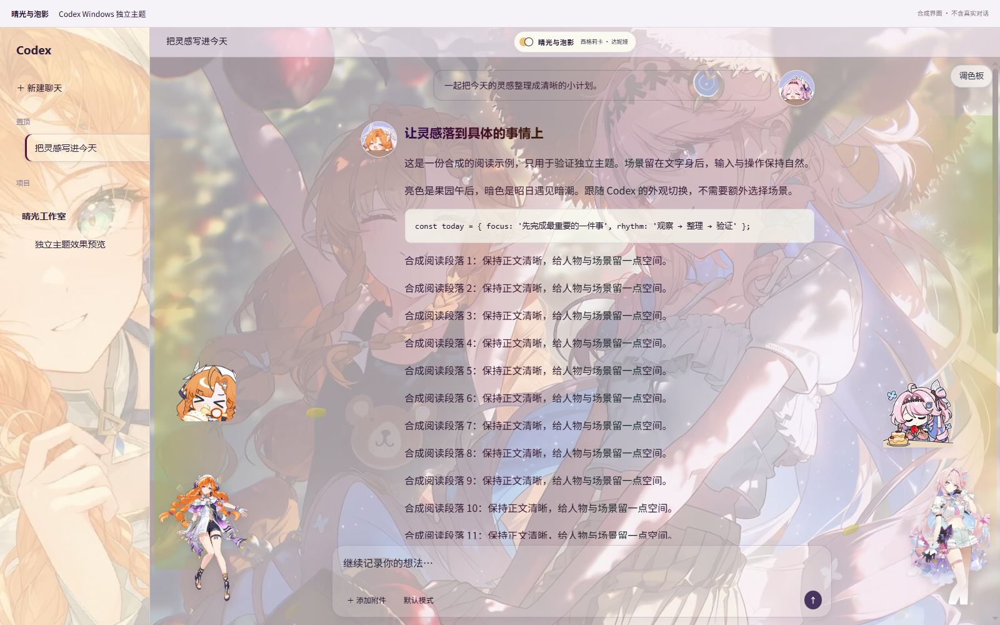
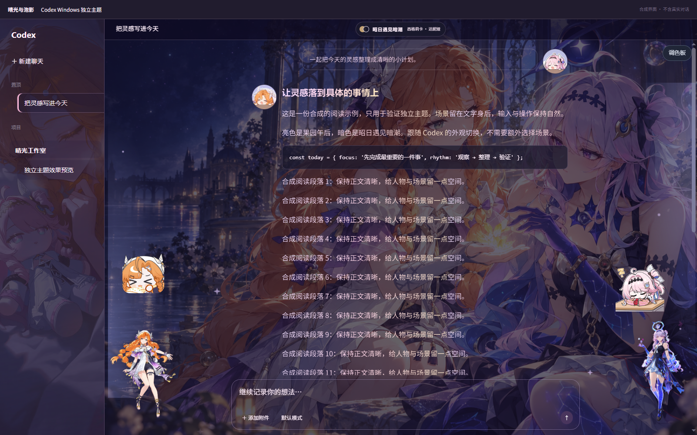

# 晴光与泡影 · Sunlit Tides for Codex

西格莉卡 × 达妮娅的 Windows Codex Desktop 独立主题。亮色是「果园午后」，暗色是「昭日遇见暗潮」，跟随 Codex 的外观设置切换。安装和运行不需要 Tessalume、Node.js 或单独安装 .NET。

第一版保留双侧立绘、吃饭动态表情、消息团子头像、插画侧栏、渐变文字、泡泡和调色板。果园场景使用独立人物、发束和裙摆图层；输入、滚动、后台及减少动态模式会暂停或回退。暗面的西西立绘与表情暂沿用现有素材。

| 果园午后 · 亮色 | 昭日遇见暗潮 · 暗色 |
| --- | --- |
|  |  |

以上为实际主题包绘制的合成测试界面，不含用户真实对话。

## 安装

1. 安装并登录 Windows 版 Codex Desktop。本版面向 Windows 11 x64。
2. 解压 `SunlitTidesCodex-1.0.0-win-x64.zip`，双击 `Install.cmd`。
3. 使用桌面或开始菜单的「Codex · 晴光与泡影」启动。当前已有可连接的 Codex 时，会直接应用；无需退出聊天。

安装位置是 `%LOCALAPPDATA%\SunlitTidesCodex`。安装器创建自己的桌面、开始菜单和当前用户登录启动项，不需要管理员权限。托盘常驻程序在登录 Windows 时启动带主题的 Codex，后续打开窗口或登录完成后自动加载。首次加载图片可能需要数秒。

**启动边界：** Codex 目前没有已验证的持久主题 API。本项目通过仅限本机的调试连接加载主题；如果彻底退出 Codex，再从商店原始入口、旧任务栏固定项或直接 EXE 冷启动，可能没有该连接。请使用新的主题入口，或把该入口固定到任务栏。程序发现这种情况会提示，不会强制结束正在工作的 Codex。登录账号的方式和数据保持由 Codex 自己管理。

如果旧的主题管理器仍在运行，应先关闭它，避免两套程序同时覆盖外观。已有 Tessalume 可保留作为备份，但独立版不读取其安装目录、主题库、状态或更新服务。

## 使用与恢复默认

- 在 Codex 设置中选择亮色、暗色或跟随系统；主题自动选择对应场景，不再显示遮挡项目选择的相册栏。
- 点击界面「调色板」调整阅读宽度、透明度、立绘大小、文字渐变和动效。主题参数只保存在本机。
- 托盘右键选择「恢复 Codex 默认外观」可停止后续注入并移除当前主题；不清除账号、聊天、项目或 Codex 原有设置。
- 再选择「启用主题」可恢复。参数会保留。
- 双击 `Restore.cmd` 也可恢复默认；`Uninstall.cmd` 恢复默认后移除本项目的程序、登录启动项及自有快捷方式。

恢复默认不会强制重启 Codex。已经启动的本机调试端口随该 Codex 进程结束；卸载后从原始入口下次冷启动不再添加此参数。

## 本版布局修复

聊天区域保留一个原生纵向滚动容器，消除主题导致的外层额外滚动条。代码块横向滚动、长输入框、设置和右侧面板保持各自滚动。项目菜单打开时，首页装饰主动让出空间，不盖住菜单项目。

## 从源码构建

构建机需要 Node.js 22+、.NET 8 SDK 和 Windows；使用者无需这些依赖。

```powershell
npm install
npm run build:theme
dotnet run --project host -- --self-test
$env:PLAYWRIGHT_EXECUTABLE_PATH = 'C:\Program Files (x86)\Microsoft\Edge\Application\msedge.exe'
npm run test:browser
powershell -NoProfile -ExecutionPolicy Bypass -File scripts/Package.ps1
```

`theme/` 是可编辑的主题源码及素材，`host/` 是独立托盘宿主，`installer/` 是当前用户安装脚本。`dist/`、`release/` 和运行日志不进入 Git。构建脚本输出安装 ZIP 与 SHA-256 校验文件。开发检查和实机验证记录见 `docs/VALIDATION.md`。

## 来源和许可

代码按 MIT 许可提供，包含 Tessalume MIT 运行时的派生实现，已保留版权；运行时保留部分兼容属性名称，但不依赖 Tessalume 应用。

**图片、角色、GIF 与代码许可不同。** DSH 素材保留上游 CC BY-NC-SA 4.0 署名链；用户提供的插画、角色形象及 AI 处理素材不能据此宣称为本项目原创或一律 MIT。请阅读 [NOTICE.md](NOTICE.md)、[素材记录](docs/ASSETS.md) 和 `licenses/`。本地交付不代表已上传或公开发布 GitHub 仓库。
