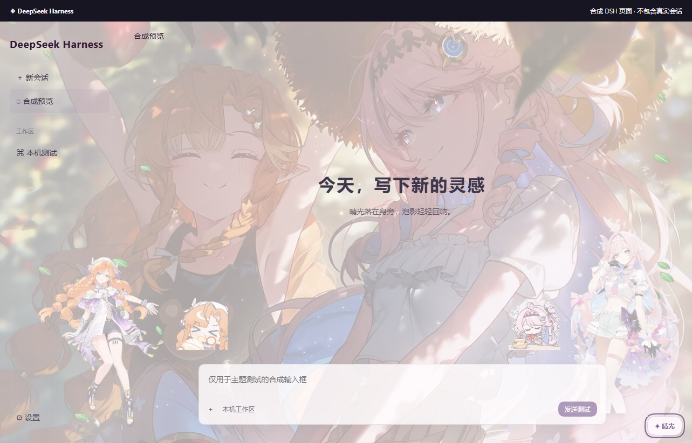
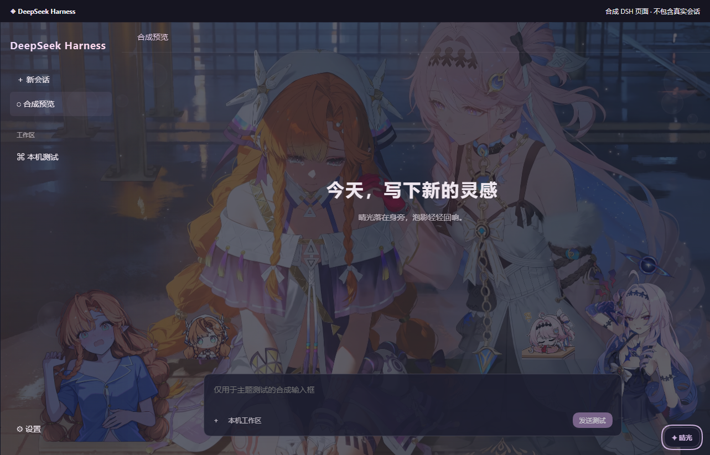

# 晴光与泡影 · DSH

西格莉卡 × 达妮娅的 DeepSeek Harness 独立动态皮肤，版本 0.1.6，动画移植自 Codex 主题 1.2.7。最初适配基线为 Windows 官方桌面端 DSH 0.2.1-rc.2；本机实际适配环境为 **DSH 0.2.1-rc.3**。未宣称其他版本或远程 Web 部署已验收。

- 跟随 DSH 亮暗外观，默认果园午后 / 夜色相依；相册保留 16 个选项，含西西动态泪光。
- 沿用 1.2.7 的亮面发辫、卷发、刘海、衣摆和呼吸实现；呼吸自然度问题单独检查，本版不重调其参数。果园午后使用带叶脉、随风翻转飘落的绿叶，夜色相依及泪光版保留泡泡，支持数量、速度及开关。独立 Worker / WebGL 按原生刷新率绘制，上限 120fps；显示器与负载决定实际帧率。
- 新增“背景贯穿 / 独立侧栏”两种布局，亮色和暗色都支持。默认采用贯穿布局：同一张动态背景连续覆盖左侧栏和主聊天区，侧栏底色柔和过渡。调色板可随时切回0.1.1的独立侧栏版，选择会保存到本机。
- 贯穿版放大双人立绘，西西位于左下并进入侧栏，与右侧表情一起向右微调。娅娅立绘放在右侧并水平镜像，表情位于其左侧；只有立绘翻转，表情保持原方向。表情遇到输入框时上移避让。背景、立绘和 GIF 共用一次透明度和阅读蒙层，随窗口、侧栏和右面板变化缩放。
- 调色板提供“立绘透明度”和“表情包透明度”，按当前 DSH 亮暗模式分别保存。默认自动跟随原有背景融合；拖动滑块改为该类装饰的独立透明度，0 隐藏、100 完全显示。“立绘跟随背景 / 表情包跟随背景”恢复自动，不改变另一类。自动叶子与背景仍只共用一次透明度。
- 西西和她的表情在贯穿版再向右微调 24px（随窗口缩放）；两侧表情遇到原生输入框都会上移避让。非果园场景从现有粒子数量中保留少量小泡泡在最右空白边缘错时升起；果园亮暗均只使用绿叶，遵守粒子开关及减少动态设置。
- 贯穿版正文与输入框不再为背景人物额外预留走廊，菜单和输入仍保持可点击；滚到输入区后方的正文正确裁切。独立侧栏版保留约 230px 高的立绘、上方 GIF 和主聊天区避让布局。
- 用户消息、助手 Markdown、标题与侧栏采用 Codex 的亮暗渐变配色；代码、链接、输入控件和状态文字保留原生颜色。调色板新增“字体渐变”开关；开启时有效阅读底色最低亮色 60% / 暗色 68%，滑块原偏好不变。
- 调色板可分别选择亮暗背景，调整阅读宽度、背景与内容透明度、人物装饰和动画开关。偏好仅保存在此 WebUI 的独立 localStorage 中。
- 输入、滚动、后台及系统减少动态模式会暂停或回退静态图；WebGL 不可用时保留原图。卸载皮肤时释放观察器、Worker、画布和监听器。

## 预览

下面是 0.1.6 实际主题包在合成 DSH 结构中的浏览器预览，不包含真实聊天。验收范围见 [联合发布说明](https://github.com/buruqu/sunlit-tides-codex/blob/v1.2.11/docs/RELEASE-1.2.11.md)；原生窗口截图未取得，不能用合成截图替代实机像素验收。

| 果园午后 | 夜色相依 |
| --- | --- |
|  |  |

## 安装与切回

在 [联合发行页](https://github.com/buruqu/sunlit-tides-codex/releases/tag/v1.2.11) 下载 `SunlitTides-DSH-0.1.6.zip`；`SunlitTides-DSH-source-0.1.6.zip` 包含可构建源码。GitHub 自动生成的 Source code 包包含整个仓库。

此插件与 Denia 分别保留。安装器通过官方 DSH CLI 注册新包，并停用旧 Denia 皮肤入口，避免两套外观同时生效。请先正常退出 DSH，安装器检测到运行进程时会停止。

发行包内 `installer/Install.ps1` 提供本机安装与备份，`installer/Restore.ps1` 使用安装记录安全恢复。恢复前会核对 profile 配置是否被后续修改，存在变化时停止，避免覆盖新的设置。完整备份与恢复参数在安装输出中给出。

安装器不自动启动或终止 DSH。安装后从原来的 DSH 入口打开即可。原有 Dragon 等启动视频属于各宿主的独立功能，不包含在本皮肤包中。

## 构建与验证

```powershell
cd dsh
npm install
npm run build
npm run test:scene
npm run test:client
npm run test:typography
npm run test:package
powershell -NoProfile -ExecutionPolicy Bypass -File scripts/Package.ps1
```

以上命令从仓库根目录开始；使用独立源码 ZIP 时先进入解压目录，省略 `cd dsh`。构建只读取本项目素材与源码，输出 `lib/client.js` 和构建指纹；这些生成文件不进入 Git，安装 ZIP 中已包含。打包输出到 `dsh/release/`，也可通过 `-OutputDirectory` 指定已有目录。Node.js 22+ 用于构建；使用插件无需单独运行 Node 或外部主题服务。浏览器检查使用 Playwright 与本机 Edge，只操作合成页面。

`scripts/sync-scene.cjs` 可从 `vendor/layered-scene-upstream.js` 重生成适配后的场景内核；它在关键接口发生变化时停止，不静默套用未知源码。

素材和代码使用条件不同，详见 [NOTICE.md](NOTICE.md)、[ASSETS.md](ASSETS.md) 和 `licenses/`。

## 2026-10-26 · 0.1.0 本机显示修复记录

修正原生暗色主题晚加载时的背景变量优先级，并清理 Conversation 结构容器的不透明底色，避免出现只有“晴光”按钮而壁纸和人物被覆盖的情况。真实 AppFrame 三列结构、晚加载暗色样式和全窗口遮挡负例已纳入浏览器测试。

修复后通过宿主热更新替换本插件客户端，无需重启 DSH。用户已在真实 DSH 窗口确认“已经显示背景和人物”。本次原生窗口截图工具失败，未取得真实窗口截图；预览图仍为合成界面，不能替代该项人工确认。安装包与本机修复客户端的 SHA-256 一致。原版 GPT 启动动画未包含在 DSH 中。

0.1.1及0.1.2的布局升级验证记录另见对应交付说明，不将这条0.1.0人工确认当作新版本验收。
